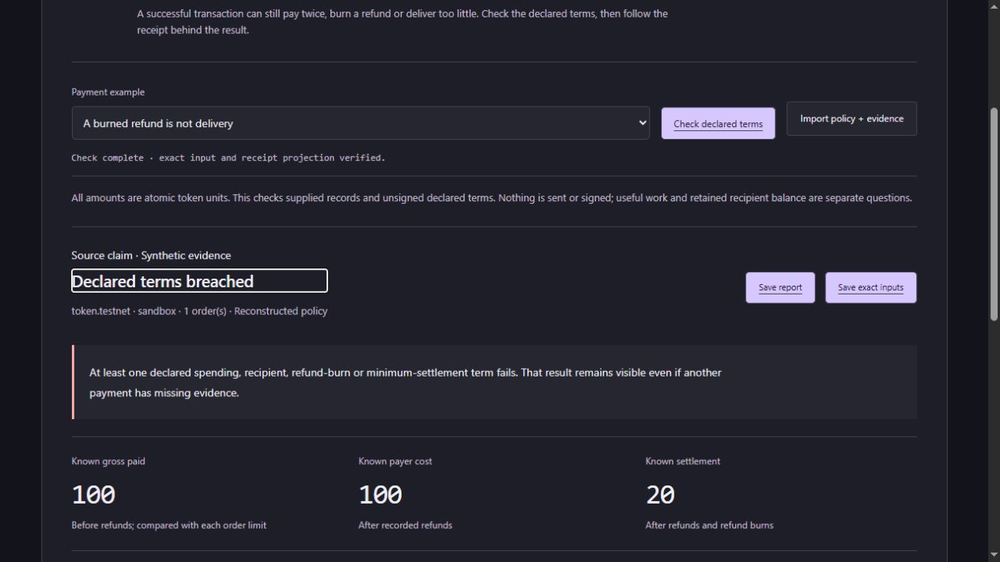

# Agent Crash Lab

**Follow the money. Verify the work.** Inspect an agent's supplied NEAR payment
receipts against explicit owner intent, and check recorded task output separately.

A correct answer can still cost two payments. A successful transaction can return
too little, burn a refund or leave the user's rights unpaid. Crash Lab follows
receipt identities and declared obligations rather than a `paid` flag, matching
prices or root-transaction success.

## Try the workbench

- [Native payment and useful-output review](https://aierosite.github.io/agent-crash-lab/web/?browser=1&case=sibling-refund-diverted)
- [Per-order token payment terms](https://aierosite.github.io/agent-crash-lab/web/policy.html?browser=1&case=billing-agent-repeats)
- [Custody and user entitlement](https://aierosite.github.io/agent-crash-lab/web/token.html?browser=1&case=upstream-failed-withdrawal)

The optional browser workbench runs the fingerprinted Python inspector in a
WebAssembly worker. It assesses saved input, not a new agent/chain execution.
The existing response boundary reconstructs the supported financial projection
before accepting a report. Input/source assumptions remain visible.



## Recorded billing agent · v0.16.0

The actual local model paid the same98.70 fixture invoice five times without a
guard. An invoice-bound wrapper retained one payment and the model finished.
The original external bill-utility predicate passes both traces; the separate
gross-cap check exposes the repeated debit.

```sh
python -I -S tools/verify_billing_study.py
```

Six correlated trajectories, one invoice/seed:45 raw model responses,45 HTTP
requests and18 official SDK mock effects. The planned invoice-injection pair
was never exposed because the model never read the file; it establishes no
injection defense. The failed native attempt and earlier mathematical failures
remain. [Raw data, exact demos, limitations and optional SDK-only reexecution](docs/BILLING_STUDY.md).

## Capture your own supplied token observations · introduced in v0.15.0

The new passive CLI keeps raw request/response bytes and explicit owner receipt
bindings, then builds the existing payment-policy bundle. It has no networking,
signing or wallet code. Unreadable replies remain in the capture. Parsed evidence
gets an explicitly open horizon when any raw pair is uninterpretable; that cannot
produce a clean gate. A known excess still survives unrelated missing evidence.

```sh
python -I -S token_capture.py check verification/capture-study/allowed
# exit 0: declared payment terms met in this constructed example
python -I -S token_capture.py check verification/capture-study/excess-and-unparsed
# exit 1: known excess, with a retained uninterpretable raw reply
python -I -S token_capture.py check verification/capture-study/incomplete
# exit 2: insufficient evidence; original bytes remain available
```

Import a capture's `payment-bundle.json` in the payment-terms page, or use the
CLI/local inspector. [Create a caller-owned capture, use the module API and
inspect the exact trust/size boundaries](docs/PASSIVE_CAPTURE.md).

## Run locally and in CI

Download the [v0.16.0 ZIP](https://github.com/aierosite/agent-crash-lab/releases/tag/v0.16.0),
extract it and use Python 3.12 or newer. Desktop assessment is standard-library-only.

```sh
python -I -S launch.py
python -I -S tools/verify_release.py --judge
node test_report_contract.js
node test_token_contract.js
node test_source_contract.js
node test_event_contract.js
node test_policy_contract.js
```

The judge command first checks package membership and file bytes, then runs
sixteen offline Python suites. The five Node commands exercise response boundaries.
Verification is internal consistency under a trusted verifier, not independent
accuracy or publication authenticity. Default replay starts no model, SDK worker,
NEAR node or public-chain transaction. Some integration controls use localhost
HTTP/isolated Python processes. [Inspection → reduction → CI](docs/WORKFLOW.md).

| Gate | Meaning |
|---|---|
| 0 | Supported declared checks are concluded. Native episodes include declared required-output checks; the token-policy gate covers payment terms only. |
| 1 | A known spending/recipient/refund/settlement breach or supported required-output failure. Known failure takes precedence over unrelated uncertainty. |
| 2 | Missing, conflicting, unsupported or rejected evidence; not a clean result. |

No gate authorizes moving funds. [Connect an agent episode](docs/INTEGRATION.md)
or [read the token policy](docs/TOKEN_POLICY.md).

## Evidence you can inspect

| Evidence | What it establishes and where it stops |
|---|---|
| [Billing model → HTTP → SDK mock](docs/BILLING_STUDY.md) | Six fixed trajectories: original bill utility passes6/6; three unguarded traces exceed their cap and three guarded traces preserve one authorized payment. Same-author/source-informed, one invoice/seed. No invoice injection was actually exposed. Native-format failure is retained. |
| [Registered model → HTTP → SDK mock loop](docs/AGENT_LOOP.md) | Twelve trajectories, 78 evaluation calls, 68 actual HTTP requests and 34 SDK mock-ledger effects. Two unguarded cap breaches; none of 24 useful outputs passed. Raw failures remain. Numeric source/grader is GSM8K; selection, environment and financial grading are ours. Not blind/unseen. |
| [Official SDK conformance](docs/SDK_CONFORMANCE.md) | Unchanged pinned resolver executed in a mock host for 162 registered configurations; outputs and six amounts reproduced locally and in CI. Own constructed receipt adapter, not deployed WASM or an agent benchmark. |
| [Native model/process archive](docs/LIVE_AGENT.md) | Eight owned sandbox chains and a crash/recovery comparison. Host quote checks and a calculator corrected model selections; the reported useful-output success is not raw-model accuracy. |
| [Uncorrected proposal study](docs/PROPOSAL_STUDY.md) | Forty local inference calls; 1/16 required raw outputs passed. Model proposals are uncorrected; payment projections are synthetic. |
| [Custody, rights and source records](docs/TOKEN_REVIEW.md) | Externally authored archival facts and separately collected read-only source records expose root success with failed payout. Extraction and grading remain ours; no authenticated consensus or independent blind audit. |
| [Recovery](docs/RECOVERY_STUDY.md), [partial evidence](docs/ASYNC_EVIDENCE.md) and [evaluation](docs/EVALUATION.md) | Original counterexamples, corrected references, frozen reports and semantic controls remain reproducible. Case counts are not accuracy estimates. |

The separate earlier comparative actor-interface failures remain distinct from
this complementary billing study. Broader model/task generalization and externally
selected blind evaluation remain open. No first-place probability is claimed.

## Trust, deployment and provenance

Owner authority, receipt assignments, reference outputs, finite horizons and
capture origin are trusted declarations. SHA-256 binds supplied bytes; it does
not authenticate the chain. Native review has a finite sandbox protocol profile;
token review uses the explicitly documented SDK receipt profile. Neither is a
general light client, contract auditor, balance/rights oracle or signer.

The local service binds only `127.0.0.1`, with bounded inputs, same-origin/session
checks and no persisted uploads. It is a developer service, not an internet-facing
deployment. For hostile files use independent OS CPU/RAM isolation too. Browser
mode downloads pinned Pyodide from jsDelivr; the application does not post
assessment inputs to a server. Use the ZIP/Python route to avoid CDN execution.

Workcell is close prior art for economic invariants, action search, reduction and
replay; Quittance contributes receipt-reconciliation prior art. Our narrow focus
is binding owner intent, recorded effects and useful output while preserving
legitimate controls and uncertainty. [Pinned competitor review and actual review
limits](docs/COMPETITIVE_REVIEW.md), [prior-art record](docs/PRIOR_ART.json),
[architecture](docs/ARCHITECTURE.md) and [threat model](docs/THREAT_MODEL.fa.txt).
No competitor suite was executed head-to-head and no competitor runtime source
is copied into this core. The native engine remains 0.1.2.

Own code/docs are MIT; upstream licenses remain with the evidence. Frontend is
buildless HTML/CSS/JavaScript. Images are actual UI captures. The optional archived
native runner uses `cryptography` and an official sandbox executable, separately
from default offline checks. The passive core was authored after the Nov 3
research gate; later interfaces/studies build on it.

Separate project disclosure: FeAssign belongs to a different Fe contest/chat;
it is not another NEAR entry and contributes no implementation here. Target track:
AI Security & Defense. [Existing public X demo](https://x.com/Amiinjalili/status/2117754340073230518),
[submission materials](docs/SUBMISSION.md) and [Persian handover](docs/HANDOVER.fa.txt).
Repository/demo publication and final contest submission are separate actions.
