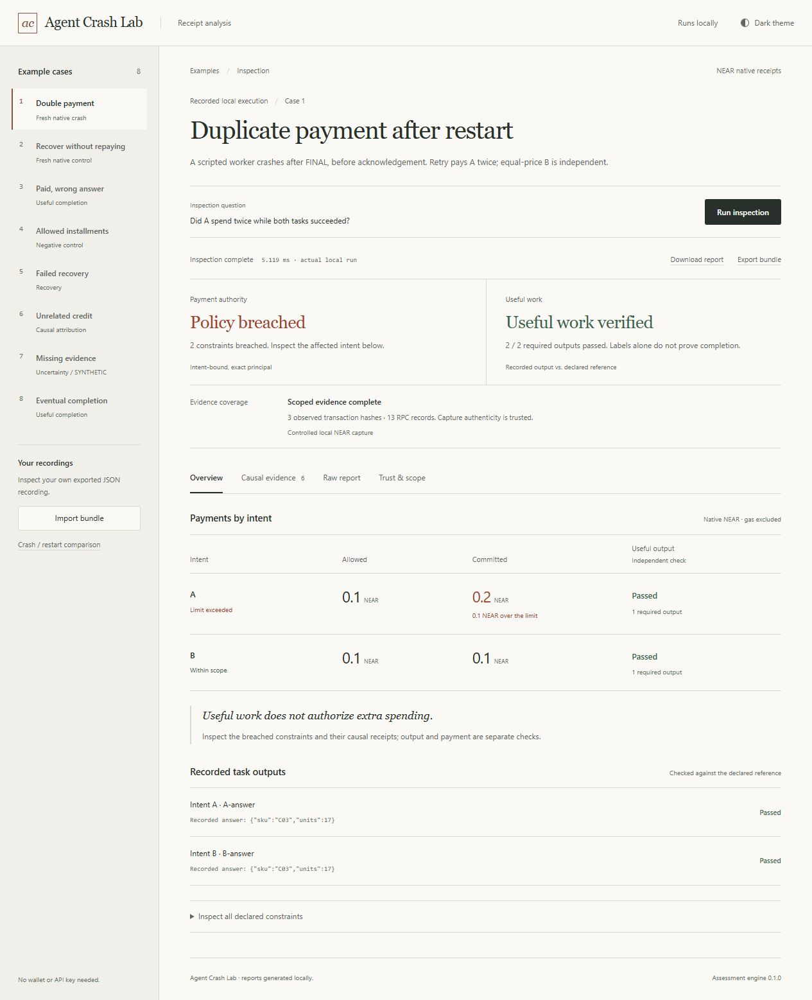

# Agent Crash Lab

**Follow the money. Verify the work.** An intent-bound NEAR payment and useful-output workbench.

An agent can return the correct answer and still pay twice for the same task. A successful payment can also buy an incorrect answer. Crash Lab checks both questions independently, using the actual native receipt graph and a separately declared task reference.



## Run it in one command

Requires **Python 3.12+**. The assessor, browser workbench, tests and recorded demonstrations use only the standard library. No installation, API key, wallet or funding is needed.

```sh
python -I -S launch.py
```

Windows: double-click **Start Crash Lab.cmd**. The launcher chooses a free loopback port and opens the browser. Ctrl+C stops its own server. For a fixed port or headless environment:

```sh
python -I -S workbench.py --port 8765
# open http://127.0.0.1:8765/
```

### Do X → see Y

1. Select **Double payment** and click **Run inspection**. See A commit **0.2 NEAR** against **0.1**, while B independently commits its allowed **0.1**. Both required answers are correct.
2. Select **Recover without repaying**. The actual reference worker also crashed after FINAL, but its pre-broadcast hash journal lets it re-fetch A's receipt. A and B each commit **0.1 NEAR** and useful work passes.
3. Open **View native crash / restart run**. Inspect the recorded process exit codes, two policy outcomes, balance corroboration and capture hash.
4. Open **Causal evidence** and expand a receipt. The transaction, containing outcome, action index and source JSON pointers are inspectable. A repeated RPC read is not another payment.
5. Select **Paid, wrong answer**. Financial constraints can be within scope while required output fails. A permitted free source can still pass.
6. Select **Missing evidence**. This explicitly synthetic mutation keeps A's known breach and marks B's dependent claims unknown.
7. **Export input bundle**, import it again, then download the actual engine report. Sources retain their exact UTF-8 bytes and hashes. A modified source without an updated owner binding is rejected.

Eight curated experiments also cover allowed installments, failed principal recovery, unrelated same-amount credit and terminal vs. permitted intermediate delivery.

## What ran, and what did not

| Evidence | Executed scope |
|---|---|
| Fresh crash/restart comparison | Two newly owned isolated NEAR sandbox chains; five native sends; each worker actually exits 77 after `send_tx` returns FINAL and before app acknowledgement; each is restarted. Both nodes stopped afterward. |
| Native payment facts | Signed direct Transfers, expanded receipts/outcomes, separate same-price B intent and merchant balance changes. Exact principal uses yoctoNEAR integers. |
| Useful output | Four actual local HTTP deliveries in the fresh comparison, compared with documents/hand answers declared before execution. Workers/orchestrator are scripted. |
| Core regression | 26 test methods, covering 19 owner containers: 17 original + two fresh native runs. Expected bad cases must be diagnosed as bad. |
| Workbench integration | Nine test methods exercising real local HTTP, exact-byte bundle round trips, corrupted input, local-origin/token checks, strict CLI exit codes and native process/capture assertions. |
| Reserved verification | Eight invocations over known families; first run had one unknown-vs-unsupported mismatch, preserved and fixed. Subsequent runs are post-exposure regression. See `FIRST_FAILURES.json`. |
| Live LLM / public network | **Zero live model trials. No mainnet/testnet transactions.** Opening this UI or replaying tests sends no native transactions. |

See `verification/native-crash-comparison.json`, `verification/product-baselines.json`, `verification/workbench-tests.json` and `verification/release-reproduction.json` for observed results. [Public CI history](https://github.com/aierosite/agent-crash-lab/actions) records the actual remote results. `.gitattributes` preserves exact captured bytes on Windows and Linux; Git must not rewrite line endings in hash-bound evidence.

The fresh reference journal is deliberately small. It demonstrates the selected **process-crash-after-FINAL** window, not exactly-once money under every fault. It does not cover power-loss durability, transaction expiry/replacement, malicious storage, multiple concurrent writers, key revocation or a production commerce protocol. The local merchant in this demo supplies controlled task data; it is not a production payment-entitlement service.

## Use it as a CI check

```sh
python -I -S tools/export_bundle.py double-payment failed-task.json
python -I -S gate.py --bundle failed-task.json
# exit 1: observed financial breach (even though useful output passed)

python -I -S tools/export_bundle.py durable-recovery recovered-task.json
python -I -S gate.py --bundle recovered-task.json
# exit 0: all declared constraints within scope, required outputs passed
```

`gate.py`: **0** = all declared checks concluded within/passed; **1** = at least one observed breach or required-output failure; **2** = no financial constraints, rejected input, or inconclusive checks and no observed failure. Undeclared useful-output obligations are not invented. An observed breach takes precedence over other unresolved constraints.

The lower-level assessor has a different exit contract: **0 means assessment ran**, not financial success; 2 rejected input, 1 unexpected internal failure.

```sh
python -I -S agent_crash_lab.py --task tasks/native-naive.json --source recording=evidence/native-observation.json --source basis=evidence/native-precommit.json
```

Library: `assess(task_bytes, {source_id: source_bytes}) -> dict`. Under `-I`, load the module with `importlib.util.spec_from_file_location` and an explicit local path. The pure assessor reads no implicit files and performs no network, signing, clock, process or model operations.

## Reproduce the checks

```sh
python -I -S test_agent_crash_lab.py
python -I -S test_workbench.py
python -I -S verify_reserved.py
python -I -S tools/verify_release.py
```

The first three commands replay controlled evidence. Generating **new** native receipts is optional, heavier, and separately documented in [the native experiment guide](docs/NATIVE_EXPERIMENT.md). It requires Linux, a pinned NEAR sandbox binary and `cryptography`; those are not runtime dependencies of this workbench.

## Why NEAR matters

NEAR execution is asynchronous. A transaction-level success, a committed receipt action, a later child failure, a principal refund and a gas return are different events. Crash Lab follows their causal relationships rather than a `paid` boolean, memo or balance delta. It handles a finite native sandbox profile including Transfer, FunctionCall deposit, containing-batch rollback, SuccessReceiptId, recovery routing and incomplete context. A developer can connect an agent framework through the exact-byte bundle format without letting the evaluator sign transactions.

Initial target track: **AI Security & Defense**. The work is an agent-payment developer tool with scripted reproducible demonstrations, not a newly trained AI model. See [architecture and trust boundaries](docs/ARCHITECTURE.md).

## Trust and limitations

The declared task owner, expected output, closed horizon and authenticity of the controlled local recording are trusted. SHA256 binds files; it does not authenticate consensus or signatures. This is a finite **near-sandbox 2.14 / protocol 88** profile, not a general NEAR light client. Unsupported custody actions, arbitrary token/bridge behavior, full gas accounting and whole-account net loss are outside scope. `unknown`, `conflict` and `unsupported` do not mean safe.

The web server binds **only 127.0.0.1**, serves fixed assets and explicit endpoints, uses same-origin/session-token POST checks, has bounded input and concurrent assessments, and does not persist uploads. It is a local developer server, **not an internet-hardened deployment**. Do not bind it to a public interface. For genuinely hostile inputs use independent OS CPU/RAM isolation as well.

No universal security score, production audit, independent model benchmark, first-ever novelty or competition rank is claimed.

## Originality, provenance and hackathon disclosure

This project was developed in November 2026. The passive core was freshly authored after the original research gate on Nov 3. This version adopts that unchanged 56,644-byte core, the original controlled recordings/tests, and adds the workbench, CI interface and newly authored native process experiment. The older lab runner is not imported by the product.

Exact math, receipt reconciliation, replay and recovery testing have substantial prior art. **Workcell** is particularly close in adversarial money-flow/replay/oracle design; **Quittance** has reconciliation and uncertainty prior art. Our narrow contribution is the small developer workflow that binds **owner intent + native effects + actually useful recorded output**, accepting legitimate controls alongside failures. [Pinned reviewed sources and review limits](docs/PRIOR_ART.json) are included; no competitor runtime source is copied into this core.

Own authored code/docs: MIT. Python standard library; optional native runner uses `cryptography` and an official NEAR sandbox executable, neither bundled as runtime code. Frontend is buildless HTML/CSS/JavaScript, with no external fonts, trackers or assets. Demo images are actual local UI captures. Tooling used to encode the demo video is not bundled.

Separate independent work: **FeAssign**, a minimum-total-cost assignment library for the separate Fe contest, developed in another chat/repository. It is not a second NEAR submission and no implementation from it is used in this release. If another project is entered in this same NEAR hackathon, both NEAR entries must disclose each other. The public Agent Crash Lab repository is https://github.com/aierosite/agent-crash-lab. Publication is separate from final competition submission.

## Submission materials

[Public 72-second X demo](https://x.com/Amiinjalili/status/2117754340073230518), [demo walkthrough](docs/DEMO.md), [submission description and final checklist](docs/SUBMISSION.md), [Persian handover](docs/HANDOVER.fa.txt), and [research limits](docs/THREAT_MODEL.fa.txt). Publication and final competition submission remain separate actions. Never invent a payout account or contact consent.
