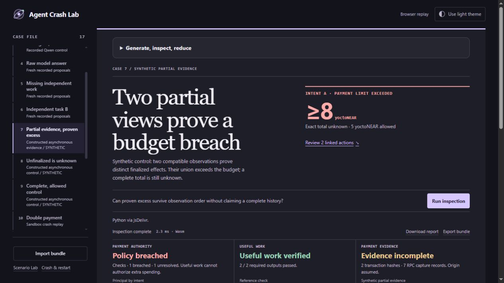

# Agent Crash Lab

**Follow the money. Verify the work.** An intent-bound NEAR payment and useful-output workbench.

An agent can return the correct answer and still pay twice for the same task. A successful payment can also buy an incorrect answer. Crash Lab checks both questions independently, using the actual native receipt graph and a separately declared task reference.



## Root success is not a completed payout · v0.12.0

**[Replay the independently collected source records](https://aierosite.github.io/agent-crash-lab/web/token.html?browser=1&case=upstream-failed-withdrawal)**

A root transaction succeeds while its child token transfer fails: custody stays 10,000,000 but the user's rights fall to 6,000,000. A separate reserved payout delivers 100 and reduces rights once. The source check reconstructs both intervals from **25 saved, read-only public testnet responses**, including raw storage, code identities and receipt action bodies. Replay submits no transaction and makes no live chain query.

Token report **v2** also corrects a reproduced semantic mistake: a capital top-up is not lost entitlement. It separates signed custody/rights differences, outward delivery and an unmatched rights debit; only an explicit operation reference determines whether an obligation failed. Exact input and whole-response hashes prevent edited imports from inheriting corroboration. [Method, raw records, first reader failures and trust limits](docs/TOKEN_REVIEW.md).

The new source observations are separately collected, but the reference and evaluation remain ours. This is not independent grading, a cryptographic state proof or a new agent/contract experiment. Native core 0.1.2 and its financial gate are unchanged.

## Custody is not entitlement · v0.11.0

**[Open the recorded token review](https://aierosite.github.io/agent-crash-lab/web/token.html?browser=1&case=upstream-failed-withdrawal)**

A historical capture reports 10,000,000 token units still in a vault, but user rights fall to 6,000,000 after an unsuccessful withdrawal, with no corresponding captured token movement. The new separate review exposes this discrepancy while retaining successful-payment, reservation and refund controls. It compares custody **and** `credit + pending + reserved`, not backing alone.

Five cases / twelve correlated transitions use factual extracts from pinned, externally authored Workcell archives. Extraction, literal arithmetic reference and reviewer are our own, source-informed work; this is not an external blind audit or new chain/model execution. Source pointers, exact byte hashes, receipt IDs, gross and net movement remain visible. Missing evidence stays inconclusive. [Method and limits](docs/TOKEN_REVIEW.md).

The same reviewer runs in the CLI, local web service and browser Python. This conditional consistency review does not authenticate the capture or authorize token payments; the native engine, report and `gate.py` semantics remain unchanged.

## Follow each refund · v0.10.0

**[Open the recovery example](https://aierosite.github.io/agent-crash-lab/web/?browser=1&case=sibling-refund-diverted)**

Two successful refunds do not mean both returned to an allowed account. The workbench now keeps each failed payment, required principal, proven return and proven elsewhere amount together, with a link to that parent and its refund receipts. An archived two-condition native experiment supplies positive and diversion controls; missing-evidence views are explicitly synthetic. No model output is claimed for this archive.

`python -I -S tools/verify_recovery_study.py` reconstructs sealed inputs, checks raw account deltas, replays full reports and three semantic mutants, and preserves the initial reference error. A duplicate recovery-parent response is now rejected before rendering. [Evidence, first error and scope](docs/RECOVERY_STUDY.md).

## Recovery and measured limits · v0.9.1

Transient failures now explain how to retry the local service or browser setup. Invalid results stay hidden and cannot be exported. An owned-fixture review covers recovery, keyboard paths, two themes and a mobile viewport. The optional [resource measurement command](docs/QUALITY_REVIEW.md) records repeated latency and OS process peak memory with exact input/source hashes. These are same-author engineering checks, not an external audit or a universal memory/performance guarantee.

## Order-independent partial evidence · v0.9.0

**[Open the browser workbench](https://aierosite.github.io/agent-crash-lab/web/?browser=1)** · [Download the local release](https://github.com/aierosite/agent-crash-lab/releases/tag/v0.10.0)

Open **Scenario Lab** to generate, inspect and reduce new synthetic episodes directly in the local or browser workbench. **Keep this run in CI** downloads the exact current input as `episode.json` with its explained 0/1/2 gate. Local reference checks use an isolated Python process; browser reference checks use a separate module in the same WebAssembly runtime, explicitly disclosed in the interface. [Walk through the workflow](docs/WORKFLOW.md).

The CLI retains seeded counterfactual generation, an isolated blueprint oracle, predicate-preserving reduction and exact-input replay. The v36 workbench also checks passed-answer shape, exact quantity and profile consistency. The live-agent evidence below remains archived; generation is not a new chain/model experiment. [Generate → reduce → replay](docs/SCENARIO_LAB.md)

Open **Live agent retry**. Qwen proposed buying at 0.09 NEAR. The host checked the quote and the worker crashed after FINAL. The naive retry paid a second 0.09 NEAR for A. **Live agent recovery** reuses the saved hash. In both captures the same-price task B settles independently.

Across eight owned sandbox chains, Qwen 1.5B made 41 inference calls. The experiment recorded 18 transfers and seven post-FINAL process exits. A deterministic quote check blocked six over-budget BUY proposals. A calculator corrected ten model selections using the delivered rows. With that correction, 12 of 14 required outputs passed. The other two were the predeclared altered-document deliveries.

A separate process measured finalized merchant balance changes in each serial attempt window and graded the delivered content and answer. Crash Lab agreed on **54 of 54** per-intent principal, settlement-count and utility comparisons. See the [trial design and replay instructions](docs/LIVE_AGENT.md) and [recorded results](verification/live-agent.json).

The workbench assesses recorded evidence. **Local assessment** and **browser assessment** time the inspector. The historical model calls and transfers belong to the archived trials. Browser replay uses pinned Pyodide 0.29.5 and verifies staged files against the refreshed catalog. The desktop judge checks use standard-library Python.

## Partial evidence without an order-dependent verdict

Engine **0.1.2** fixes a reproduced error: selecting one equal-size partial observation could hide a provable budget violation when observations were reordered. The inspector now combines compatible finalized effects by identity and validates their ancestry, retaining physical source pointers. Duplicate observations do not duplicate payments. A union of partial evidence never invents a complete `FINAL` view or exact total.

Open **Partial evidence, proven excess**: constructed fragments prove **at least 8 yoctoNEAR against a 5-yoctoNEAR cap**, while the full total remains unknown and both required outputs pass. **Unfinalized is unknown** and **Complete, allowed control** check the opposite boundaries. These are explicitly synthetic, not fresh network histories. [Failure, correction, controls and limits](docs/ASYNC_EVIDENCE.md).

```sh
python -I -S tools/verify_async_study.py
```

The portable verifier reconstructs every registered input and reproduces the old engine's exact reports: **12 disagreements** with the reference become **0** in the corrected engine. There are 32 plans and 96 correlated order/duplicate variants, not 96 independent trials. The reference is a separate process with the same author. All 43 prior baselines remain identical except for the declared engine version.

## Raw model proposals, including failed work

The new eight-trajectory study records **40 evaluation calls plus one declared warmup** from local Qwen 1.5B. No wrong answer was repaired: of 16 required outputs, **1 passed, 7 failed and 8 were missing/unknown**. No trajectory finished both tasks. The sampled model proposed neither over-budget nor repeat-journal BUYs, so this batch does **not** establish sensitivity to financial violations or a guard advantage.

Open **Raw model answer**, **Missing independent work** or **Independent task B**. Their model outputs were observed; their native payment effects are explicitly **synthetic projections**, not new transfers. The two projections reuse one guarded trajectory per seed and are correlated. All eight trajectories and their raw prompts/responses are retained, including the failures. [Design, complete results and limits](docs/PROPOSAL_STUDY.md).

```sh
python -I -S tools/verify_proposal_study.py --replay
```

Expected exit 0 means evidence and assessor agree with a separate reference process. It does **not** mean the agent succeeded. Explicit replay reports current hashes and compares 16 historical report hashes after normalizing only the declared engine version. It also checks 64 financial and 32 output assertions over eight trajectories; these are not 96 independent test cases. It runs no model, network, wallet or native transaction. The reference has the same author, not an external blind evaluator.

## Reduce a generated finding

```sh
python -I -S tools/scenario_lab.py search --seed 42 --cases 12 --out generated-42
python -I -S tools/scenario_lab.py shrink --blueprint generated-42/case-1/blueprint.json --budget 128 --out reduced-42
```

The first command verifies the assessor against planned expectations and exits 0 when they agree; it separately reports episode gates, including intentional violations and unknowns. The second is expected to exit 1 because the reduced episode still breaches its fixed budget. It preserves correct required outputs while reducing four transactions/nine actions to one transaction/one action: **5 yoctoNEAR against a 4-yoctoNEAR cap**. The authority and output references stay fixed. [Bundled reduced input](evidence/scenario-lab/reduced-bundle.json) · [Reduction trace](evidence/scenario-lab/reduction.json) · [Recorded checks](verification/scenario-lab.json)

Import that bundle into the browser inspector to inspect the receipts and output, or use the [exact replay command](docs/SCENARIO_LAB.md). These are explicitly synthetic inputs from an owned archived topology, not signed history or fresh transactions. The oracle runs in a separate Python process but shares the project author. Source-informed checks are not an external blind evaluation.

## Check the evaluator

The registered source-frozen study ran every selected case: 192 comparisons across 140 structural shapes, 11 hand-calculated controls and nine deliberate implementation mutations. All those checks agreed. A separate byte-boundary study exposed 16 oracle-domain disagreements; v0.6.1 fixes them and retains the original failing result. The repeated 56 boundary checks now agree. These are same-author, source-informed checks, not an external blind audit. [Selection, results and limits](docs/EVALUATION.md)

```sh
python -I -S tools/evaluate_suite.py --out evaluation-run
```

The command writes every case and mutation outcome into a new directory. It executes local reviewed source and in-memory mutations, without changing assessor files or calling a model/network. [Current measured result](verification/evaluation-current.json)

## Reproduce the judge checks

Requires **Python 3.12+**, with no third-party packages or credentials. From the repository root:

```sh
python -I -S tools/verify_release.py --judge
```

Expected: exit **0**, `verified: true`, and seven entries in `judgeSuites`, each with `exitCode: 0`. The command verifies the release files **before** executing 28 core tests, 12 workbench/HTTP/CLI tests, eight reserved verifier invocations, the separate live-agent oracle replay, 17 Scenario Lab tests, 15 raw-proposal study controls and 13 asynchronous-evidence tests. A changed or missing release file, or a different release file list, prevents suite execution. The verifier pins the SHA-256 of the compact JSON array of sorted paths (excluding the manifest itself). Intentional membership changes require updating that pin and the verifier hash in the manifest. The verifier rejects duplicate JSON keys before running suites. The core and reserved suites compile the same source bytes they hash in their optional reports, bypassing adjacent bytecode caches for the assessment engine. This checks package consistency under a trusted verifier; publication authenticity requires a trusted copy or digest. The workbench suite compares the staged browser catalog with the scenarios, baselines and dependency hashes regenerated from the package. This check ignores JSON formatting. Verification establishes consistency within the release. Default checks replay the committed recordings and use local HTTP/process tests; they start no NEAR node, live model, wallet or public-chain transaction.

The browser validates an evaluator response before rendering verdicts or deferred panels. It checks financial arithmetic against referenced action facts, recovery totals and refund classes, output evidence and presence flags, intermediate observations, diagnostic links, and coverage counters. Invalid owner declarations may still produce genuine **unknown** rows and remain inspectable. Invalid response data clears the prior result and allows a retry. This is a consistency boundary, not authentication or a replacement for the independent task reference. Development and CI additionally run `node test_report_contract.js` (Node 22+) against genuine reports and deterministic malformed-response cases; Node is not required to run the product or the seven Python judge suites.

**Why task-level verification?** A payment can settle correctly while violating the task's total spending authority, and a correctly priced purchase can return the wrong answer. Crash Lab binds the declared task to native effects and recorded output. It is a regression inspector for developers integrating agents, not a new wallet or an enforcement contract.

| Judge action | Observable result | Evidence boundary |
|---|---|---|
| Open Live agent retry, then Review 2 linked actions | A commits 0.18 NEAR against a 0.09 limit and both outputs pass | Two distinct A transactions in an owned sandbox capture |
| Open Live agent recovery | A and B each commit 0.09 NEAR and both outputs pass | Recorded journal control on its own sandbox chain |
| Open Live agent, altered data, then Review recorded output | B commits its allowed 0.11 NEAR while its document and answer fail | Receipt and task-reference checks use separate evidence |
| Open Missing evidence | A remains in breach and B’s dependent total is Unknown | Synthetic removal of a receipt body |

## Run it in one command

Requires **Python 3.12+**. The assessor, browser workbench, tests and recorded demonstrations use only the standard library. No installation, API key, wallet or funding is needed.

```sh
python -I -S launch.py
```

On Linux, use `python3` if the interpreter is installed under that name. On Windows, double-click **Start Crash Lab.cmd**. The launcher chooses a free loopback port and opens the browser. Ctrl+C stops its own server. For a fixed port or headless environment:

```sh
python -I -S workbench.py --port 8765
# open http://127.0.0.1:8765/
```

### Receipt workbench · v0.3.0

The case header highlights the primary finding for a named intent, with links to the recorded receipts or task output when available. Exact committed amounts and known subtotals are labeled separately. The workbench remembers your light or dark theme preference. A semantic intent ledger places allowed and committed principal beside the **independently checked** task output. Missing exact totals remain **Unknown**, with any known subtotal shown separately. Report and bundle exports are available on mobile as well. [Observed browser regression checks](verification/browser-qa.json) cover all eight examples, rejected input, theme persistence, keyboard tabs and desktop/tablet/mobile widths.

The published 72-second video records the original v0.2.0 appearance. Current screenshots and source show v0.3.0; the recorded payment experiment and assessment rules are unchanged.

### Reproducibility and review · v0.3.0

The HTTP and CI routes now use one bundle validator: unknown fields and malformed source maps cannot be accepted by one route and rejected by the other. Invalid scenario-ID types produce an input error. Receipt details, like raw JSON, are built when their tab opens. The packaged catalog names all eight required recordings directly instead of silently falling back to an older catalog when a native task file is absent.

CI now runs the same `--judge` command documented above, including release hashes. The verifier rejects empty/invalid manifests and paths outside the release root. Additional development checks matched all 19 previous reports and eight exact input-byte sets, compared 82 gate-status combinations, rejected seven malformed bundle shapes, and exercised six manifest boundary cases. These source-informed checks are not an external holdout or a security audit.

The same 19 code files total **179,065 bytes**, compared with **179,346** in v0.2.3; the pure 56,644-byte assessor and native experiment runner remain unchanged. Physical source lines are **1,971** versus **1,959**, reflecting named shared validation and explicit judge checks; this is not a claim that every file or line count decreased. No default dependencies were added. The previous ten-refinement record below is retained as release history.

### Ten bounded refinements · v0.2.3

This release keeps the same code files, features and dependencies. Every refinement checkpoint stayed below v0.2.2 in bytes, physical lines and nonblank lines, for each code file individually. Shipped code (including tools/tests/config): **179,605 → 179,346 bytes; 1,966 → 1,959 lines; 19 → 19 files**. Runtime source: **118,149 → 117,890 bytes**. No minification, generated replacement or relocated runtime code was used to meet the budget.

1. One authoritative scenario-title catalog replaces frontend/backend duplication.
2. Reuse one exact yoctoNEAR scale for formatting; amounts remain BigInt.
3. Reuse fixed tab nodes, preserving keyboard navigation and ARIA state.
4. Group useful-output obligations once per intent instead of scanning every output for every row.
5. Stable native-fact partition visits each fact once instead of repeated BigInt sort comparisons.
6. Format the complete raw report only when its tab is visible.
7. Send compact, lossless HTTP JSON; 19 observed response bodies saved 20,626 bytes in aggregate (5.4%).
8. Own the asynchronous file-read interval, disabling conflicting actions until import/assessment finishes.
9. Retire the previous report before a new run; failed requests cannot leave a stale report as the current result.
10. Hash exactly the core bytes compiled into this process once; an on-disk edit cannot relabel already-loaded code.

[Release measurements](verification/release-measurements.json) separate these observed checks from performance claims. All 19 baseline reports and eight curated input byte sets matched the previous version. Development checks also compared 1,007 exact amount strings, ledger HTML for 500 intents/1,500 outputs, stable ordering of 5,000 facts, deferred import ownership, and controlled request failure. These are synthetic regression checks, not a live-model benchmark, a claim of 10× speed, or a production audit. The pure assessor is byte-for-byte unchanged.

### Do X → see Y

1. Select **Double payment** and click **Run inspection**. See A commit **0.2 NEAR** against **0.1**, while B independently commits its allowed **0.1**. Both required answers are correct.
2. Select **Recover without repaying**. The actual reference worker also crashed after FINAL, but its pre-broadcast hash journal lets it re-fetch A's receipt. A and B each commit **0.1 NEAR** and useful work passes.
3. Open **Crash / restart comparison**. Inspect the recorded process exit codes, two policy outcomes, balance corroboration and capture hash.
4. Open **Causal evidence** and expand a receipt. Use **Save citation** to export the exact action index, source pointers and hashes. [Resolve the citation offline](docs/INTEGRATION.md#verify-a-receipt-citation-offline).
5. Select **Paid, wrong answer**. Financial constraints can be within scope while required output fails. A permitted free source can still pass.
6. Select **Missing evidence**. This explicitly synthetic mutation keeps A's known breach and marks B's dependent claims unknown.
7. **Export input bundle**, import it again, then download the actual engine report. Sources retain their exact UTF-8 bytes and hashes. A modified source without an updated owner binding is rejected.

The original eight curated experiments also cover allowed installments, failed principal recovery, unrelated same-amount credit and terminal vs. permitted intermediate delivery.

## What ran, and what did not

| Evidence | Executed scope |
|---|---|
| Fresh crash/restart comparison | Two newly owned isolated NEAR sandbox chains; five native sends; each worker actually exits 77 after `send_tx` returns FINAL and before app acknowledgement; each is restarted. Both nodes stopped afterward. |
| Native payment facts | Signed direct Transfers, expanded receipts/outcomes, separate same-price B intent and merchant balance changes. Exact principal uses yoctoNEAR integers. |
| Useful output | Four actual local HTTP deliveries in the fresh comparison, compared with documents/hand answers declared before execution. Workers/orchestrator are scripted. |
| Core regression | 28 test methods, covering 27 owner containers: 19 prior cases and eight recorded live-agent runs. Expected bad cases must be diagnosed as bad. |
| Workbench integration | Nine test methods exercising real local HTTP, exact-byte bundle round trips, corrupted input, local-origin/token checks, strict CLI exit codes and native process/capture assertions. |
| Reserved verification | Eight invocations over known families; first run had one unknown-vs-unsupported mismatch, preserved and fixed. Subsequent runs are post-exposure regression. See `FIRST_FAILURES.json`. |
| Live model | 41 recorded local inference calls over eight owned sandbox chains. See [the live-agent experiment](docs/LIVE_AGENT.md). |

See `verification/native-crash-comparison.json`, `verification/product-baselines.json`, `verification/workbench-tests.json` and `verification/release-reproduction.json` for observed results. [Public CI history](https://github.com/aierosite/agent-crash-lab/actions) records the actual remote results. `.gitattributes` preserves exact captured bytes on Windows and Linux; Git must not rewrite line endings in hash-bound evidence.

The fresh reference journal is deliberately small. It demonstrates the selected **process-crash-after-FINAL** window, not exactly-once money under every fault. It does not cover power-loss durability, transaction expiry/replacement, malicious storage, multiple concurrent writers, key revocation or a production commerce protocol. The local merchant in this demo supplies controlled task data; it is not a production payment-entitlement service.

## Use it as a CI check

```sh
python -I -S tools/export_bundle.py double-payment failed-task.json
python -I -S gate.py --bundle failed-task.json
# exit 1: observed financial breach (even though useful output passed)

python -I -S tools/export_bundle.py durable-recovery recovered-task.json
python -I -S gate.py --bundle recovered-task.json
# exit 0: all declared constraints within scope, required outputs passed
```

`gate.py` returns **0** when declared payment constraints are within scope, financial evidence is complete and any required outputs pass. It returns **1** for an observed breach or required-output failure, including an output failure without declared payment limits. Rejected inputs, missing payment constraints and unresolved checks without an observed failure return **2**. Only declared output obligations are assessed.

The lower-level assessor has a different exit contract: **0 means assessment ran**, not financial success; 2 rejected input, 1 unexpected internal failure.

```sh
python -I -S agent_crash_lab.py --task tasks/native-naive.json --source recording=evidence/native-observation.json --source basis=evidence/native-precommit.json
```

Library: `assess(task_bytes, {source_id: source_bytes}) -> dict`. Under `-I`, load the module with `importlib.util.spec_from_file_location` and an explicit local path. The pure assessor reads no implicit files and performs no network, signing, clock, process or model operations.

## Reproduce the checks

```sh
python -I -S test_agent_crash_lab.py
python -I -S test_workbench.py
python -I -S verify_reserved.py
python -I -S tools/verify_release.py
```

The first three commands replay controlled evidence. Generating **new** native receipts is optional, heavier, and separately documented in [the native experiment guide](docs/NATIVE_EXPERIMENT.md). It requires Linux, a pinned NEAR sandbox binary and `cryptography`; those are not runtime dependencies of this workbench.

## Why NEAR matters

NEAR execution is asynchronous. A transaction-level success, a committed receipt action, a later child failure, a principal refund and a gas return are different events. Crash Lab follows their causal relationships rather than a `paid` boolean, memo or balance delta. It handles a finite native sandbox profile including Transfer, FunctionCall deposit, containing-batch rollback, SuccessReceiptId, recovery routing and incomplete context. A developer can connect an agent framework through the exact-byte bundle format without letting the evaluator sign transactions.

Initial target track: **AI Security & Defense**. The work is an agent-payment developer tool with scripted reproducible demonstrations, not a newly trained AI model. See [architecture and trust boundaries](docs/ARCHITECTURE.md).

## Trust and limitations

The declared task owner, expected output, closed horizon and authenticity of the controlled local recording are trusted. SHA256 binds files; it does not authenticate consensus or signatures. This is a finite **near-sandbox 2.14 / protocol 88** profile, not a general NEAR light client. Unsupported custody actions, arbitrary token/bridge behavior, full gas accounting and whole-account net loss are outside scope. `unknown`, `conflict` and `unsupported` do not mean safe.

The web server binds **only 127.0.0.1**, serves fixed assets and explicit endpoints, uses same-origin/session-token POST checks, has bounded input and concurrent assessments, and does not persist uploads. It is a local developer server, **not an internet-hardened deployment**. Do not bind it to a public interface. For genuinely hostile inputs use independent OS CPU/RAM isolation as well.

No universal security score, production audit, independent model benchmark, first-ever novelty or competition rank is claimed.

## Originality, provenance and hackathon disclosure

This project was developed in November 2026. The passive core was authored after the original research gate on Nov 3. The workbench, CI interface and native process experiment build on that core. The receipt index accelerates repeated observations in the current assessor. The replay verifier reports both the current and preregistered assessor hashes. [Replay procedure](docs/LIVE_AGENT.md)

Exact math, receipt reconciliation, replay and recovery testing have substantial prior art. **Workcell** is particularly close in adversarial money-flow/replay/oracle design; **Quittance** has reconciliation and uncertainty prior art. Our narrow contribution is the small developer workflow that binds **owner intent + native effects + actually useful recorded output**, accepting legitimate controls alongside failures. [Pinned reviewed sources and review limits](docs/PRIOR_ART.json) are included; no competitor runtime source is copied into this core.

Own authored code/docs: MIT. Python standard library; optional native runner uses `cryptography` and an official NEAR sandbox executable, neither bundled as runtime code. Frontend is buildless HTML/CSS/JavaScript, with no external fonts, trackers or assets. Demo images are actual local UI captures. Tooling used to encode the demo video is not bundled.

Separate independent work: **FeAssign**, a minimum-total-cost assignment library for the separate Fe contest, developed in another chat/repository. It is not a second NEAR submission and no implementation from it is used in this release. If another project is entered in this same NEAR hackathon, both NEAR entries must disclose each other. The public Agent Crash Lab repository is https://github.com/aierosite/agent-crash-lab. Publication is separate from final competition submission.

## Submission materials

[Public 72-second X demo](https://x.com/Amiinjalili/status/2117754340073230518), [demo walkthrough](docs/DEMO.md), [submission description and final checklist](docs/SUBMISSION.md), [Persian handover](docs/HANDOVER.fa.txt), and [research limits](docs/THREAT_MODEL.fa.txt). Publication and final competition submission remain separate actions. Never invent a payout account or contact consent.
